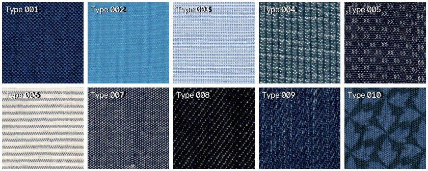
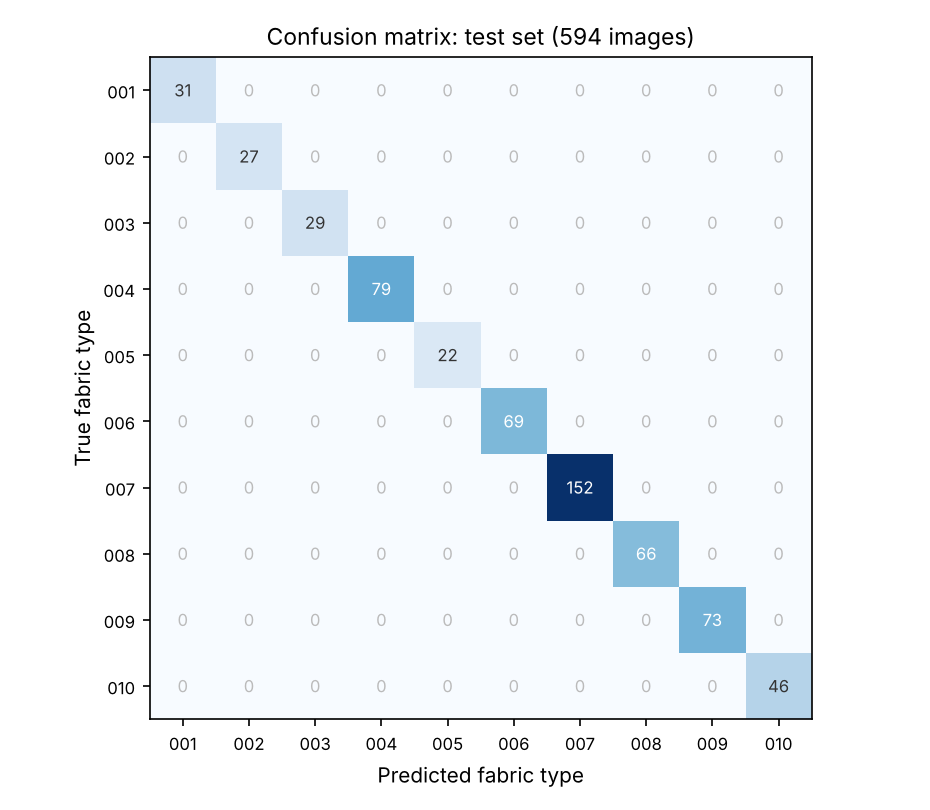

# Fabric Classification Using OpenCV

A computer-vision system that identifies the fabric type of a textile image using **Local Binary Pattern (LBP)** texture features. It trains an **SVM (RBF)** and a **Random Forest**, keeps the better one, and serves it through a **Streamlit** app with per-class probabilities.

**Results on the Ten Fabrics Dataset (TFD), 10 fabric types, 594 held-out images:**

| Model | Test accuracy | Macro F1 |
|---|---|---|
| SVM (RBF, C=10) | **100.0%** | 1.000 |
| Random Forest (200 trees) | **100.0%** | 1.000 |



Developed as an Industrial-Oriented Mini Project for the B.Tech in Computer Science and Engineering (AI & ML).

---

## Features

- Texture-based classification from a compact **26-dimensional LBP histogram**
- SVM (RBF) and Random Forest compared on the same stratified split, with the better model saved automatically
- Reproducible results from fixed random seeds
- Streamlit app showing the predicted fabric, its confidence, and probabilities for every class

## Working Pipeline

1. **Load:** images are read from one folder per fabric type and resized to 128×128
2. **Extract features:** grayscale conversion, then a uniform LBP (radius 3, 24 points) turned into a normalized 26-bin histogram
3. **Split:** stratified 80:20 train/test split (2,375 / 594 images)
4. **Train:** SVM (RBF, C=10, γ=scale) and Random Forest (200 trees)
5. **Select:** the higher-accuracy model is saved as `fabric_classifier_model.pkl`, with `label_encoder.pkl`
6. **Predict:** the Streamlit app applies the same resizing and LBP extraction to an uploaded image

## Results

### Test set (stratified 80:20 split)

Both models classify all 594 test images correctly.



### Robustness checks

TFD patches are cut from one scan per fabric, with 10% overlap between neighbouring patches. A random split can therefore place near-duplicate patches in both train and test. To check that the result isn't caused by that leakage, the models were also evaluated in two stricter ways:

| Evaluation | SVM | Random Forest |
|---|---|---|
| 5-fold stratified cross-validation | 99.8% ± 0.2 | 99.97% ± 0.07 |
| **Region hold-out:** train on the first 80% of each fabric's patches, test on the last 20% (a separate area of the scan) | 100.0% | 100.0% |
| Region hold-out, reversed: test on the first 20% | 99.3% | 100.0% |

Accuracy stays at or above 99% when whole regions of each fabric are unseen during training. So the result reflects real texture differences, not memorized overlapping patches.

> **Note:** each TFD class is a single fabric from one factory scan, which makes this an easy benchmark. Expect lower accuracy on photos of other fabrics, or under different lighting or scale. See Future Improvements.

## Dataset

[**Ten Fabrics Dataset (TFD)**](https://www.kaggle.com/datasets/saharshakir/ten-fabrics-dataset-tfd): 2,969 scanned 256×256 textile patches across 10 fabric types, labelled `001`–`010`. It was originally built for defect detection, and about 25% of the patches contain defects; they are kept here as normal samples of their fabric type.

| Type | 001 | 002 | 003 | 004 | 005 | 006 | 007 | 008 | 009 | 010 |
|---|---|---|---|---|---|---|---|---|---|---|
| Images | 154 | 136 | 144 | 396 | 110 | 345 | 760 | 329 | 367 | 228 |

The dataset is **not included in this repository**. Download it from Kaggle and extract it so the folder sits next to `model.py`:

```text
TFD Textile Dataset/
├── 001/
├── 002/
│   ...
└── 010/
```

## Technologies Used

**Language:** Python

**Libraries:** OpenCV · NumPy · scikit-learn · scikit-image · Streamlit · Pillow · Joblib

## Installation

```bash
git clone https://github.com/bsaaketh/Fabric-Classification-Using-OpenCV.git
cd Fabric-Classification-Using-OpenCV
pip install -r requirements.txt
```

### Train the model

```bash
python model.py
```

This prints accuracy and a classification report for both models, then saves `fabric_classifier_model.pkl`, `label_encoder.pkl`, `fabric_svm_model.pkl` and `fabric_rf_model.pkl`.

### Run the app

```bash
streamlit run app.py
```

## Project Structure

```text
Fabric-Classification-Using-OpenCV/
├── TFD Textile Dataset/     # not included, see Dataset
├── app.py                   # Streamlit interface
├── model.py                 # LBP features, SVM + RF training, model selection
├── requirements.txt
├── assets/                  # README images
└── README.md
```

## Applications

Textile manufacturing · automated quality control · inventory management · e-commerce product tagging

## Future Improvements

- Test on photos of fabrics outside TFD, under varied lighting and scale
- Add named material classes (cotton, denim, silk, wool…) from a multi-source dataset
- Combine LBP with GLCM, Gabor and color features, or move to CNN transfer learning
- Use TFD's defect labels to add defect detection
